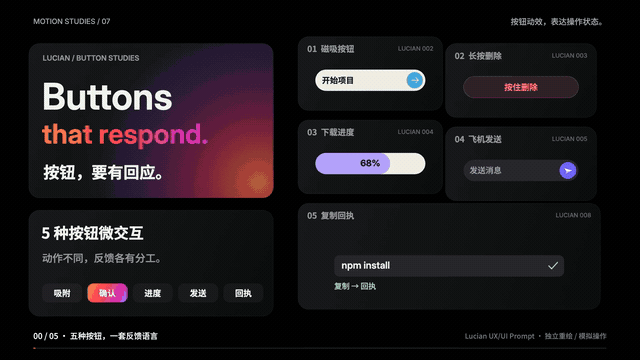

# Buttons that respond · 按钮，要有回应

20 秒知识短片 + 五种真实可操作的按钮微交互。黑色 Bento Grid 布局，同一组卡片持续重排；每种效果都有 **适用场景 + AI 提示词 + 操作反馈**。

[打开交互演示 ↗](https://jdb156158.github.io/vibe-buttons1/) · [完整 MP4](https://jdb156158.github.io/vibe-buttons1/media/button-microinteractions-20s.mp4) · [影片源码 ZIP](https://jdb156158.github.io/vibe-buttons1/media/button-microinteractions-source.zip)

## 视频效果

[](https://jdb156158.github.io/vibe-buttons1/#film)

GIF 是静音预览，点击观看完整 1080p / 60fps 视频，含原创合成配乐与音效。

## 五种按钮与提示词


| 类型 | 场景 | 可复用 AI 提示词 | 操作 |
|---|---|---|---|
| 磁吸按钮 | 主行动入口 | 做磁吸按钮，靠近吸附，离开复位。 | 指针进入，按钮与文字分层吸附；离开复位 |
| 长按删除 | 删除确认 | 做长按删除，1.2秒确认，松开取消。 | 按住 1.2 秒，红色填充走满，删除后出现撤销入口 |
| 下载进度 | 文件下载 | 做下载按钮，显示进度，完成变勾。 | 下载按钮变进度条，再变圆形勾选与保存回执 |
| 飞机发送 | 聊天发送 | 做发送按钮，飞机起飞，成功显示回执。 | 飞机飞出，消息进入气泡，显示已送达 |
| 复制回执 | 命令复制 | 做复制按钮，成功变勾，并提示已复制。 | 叠纸图标变勾，成功提示出现 |

结尾：**场景 + 动作 + 反馈**。每次点击，都值得一个回应。

## 完整制作提示词

> 用代码生成一支 20 秒、1920×1080、60fps 的知识讲解视频。选 Lucian UX/UI Prompt 的 002 磁吸箭头、003 长按删除、004 下载进度、005 纸飞机发送、008 复制回执，五项都是按钮微交互。视觉参考观默 Bento Grid：纯黑背景、深灰圆角卡片、Inter 与 Noto Sans SC 大字号，橙粉紫渐变只给标题主角。全片由同一组 7 个面板连续重排：标题、提示词、五个按钮；每段放大一个按钮，其他四个保留为缩略入口。第一帧就有五项与大标题。2 秒开场，五段各 3 秒，3 秒结尾。每段写明适用场景、提示词与操作反馈；长按确认持续 1.2 秒，下载和发送标为模拟。结尾五项汇合，强调“场景 + 动作 + 反馈”。Canvas 暴露 window.draw(t)，画面不依赖播放历史。先查九帧并修改两轮，再导出 1200 帧。Python 合成 120 BPM 配乐及操作音效，FFmpeg 输出 H.264 / yuv420p + AAC MP4。交付源码、分镜、来源和视频。


## 可交互网页

- **磁吸按钮**：指针分层吸附，离开复位，点击给出回应。
- **长按删除**：按住鼠标、手指或空格 1.2 秒确认；松开、移出或失焦取消；支持撤销。
- **下载进度**：模拟进度、再次点击取消；完成后下载一份真实示例 PDF。
- **飞机发送**：输入消息后点击或 Enter，飞机起飞，消息成为气泡并出现送达回执。仅在本页演示。
- **复制回执**：选择 npm / pnpm / bun，写入系统剪贴板成功后显示勾与提示。

支持手机布局、键盘切换、状态文字反馈与减少动态偏好。影片为确定性操作演示；网页下载使用示例文件，消息不发送至外部。

## 制作步骤

1. 核实控件和参考片，写分镜与行为规则。
2. Canvas 编写 `draw(t)`；用 7 个固定身份的面板进行重排。
3. 导出九帧，完成两轮修改后渲染 1,200 帧。
4. Python 合成音乐和音效，FFmpeg 输出 H.264 + AAC。
5. 独立实现网页交互，检查长按取消、撤销、下载、复制、触屏与键盘。
6. 发布 GitHub Pages，复查线上交互、手机布局及完整视频播放与跳转。

[制作与复现说明](docs/MAKING.md) · [可复用提示词](docs/PROMPTS.md) · [逐条来源与分镜](film/treatment.md)

## 本地预览

```sh
python3 -m http.server 4854
```

打开 http://localhost:4854/ 。视频源工程在 `film/`，网页源码在根目录和 `site/`。

## 参考

交互来自 [Lucian UX/UI Prompt](https://lucianlabs.dev/uxui-prompt/) 的 002 / 003 / 004 / 005 / 008；视觉参考 [观默 Bento Grid](https://guanmo-ai.github.io/design-style/?lang=zh#work-01-bento-grid)。本项目独立重绘与实现，未复制参考视频。字体与运行时各自许可保留在 `film/assets/fonts/` 和 `film/vendor/`。
