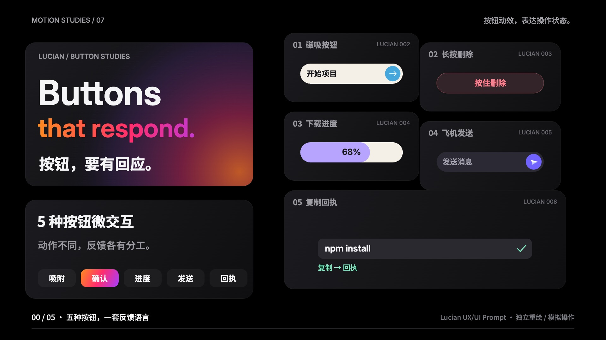

# 按钮，要有回应 · Buttons that respond

20 秒 / 1920×1080 / 60fps / H.264 + AAC。五种同类按钮微交互，用 Bento Grid 的连续重排展示「场景 + 动作 + 反馈」。



## 五种按钮与提示词

| 类型 | 场景 | 可复用 AI 提示词 | 操作 |
|---|---|---|---|
| 磁吸按钮 | 主行动入口 | 做磁吸按钮，靠近吸附，离开复位。 | 指针进入，按钮与文字分层吸附；离开复位 |
| 长按删除 | 删除确认 | 做长按删除，1.2秒确认，松开取消。 | 按住 1.2 秒，红色填充走满，删除后出现撤销入口 |
| 下载进度 | 文件下载 | 做下载按钮，显示进度，完成变勾。 | 下载按钮变进度条，再变圆形勾选与保存回执 |
| 飞机发送 | 聊天发送 | 做发送按钮，飞机起飞，成功显示回执。 | 飞机飞出，消息进入气泡，显示已送达 |
| 复制回执 | 命令复制 | 做复制按钮，成功变勾，并提示已复制。 | 叠纸图标变勾，成功提示出现 |

结尾：**场景 + 动作 + 反馈**。每次点击，都值得一个回应。

## 完整制作提示词

> 用代码生成一支 20 秒、1920×1080、60fps 的知识讲解视频。选 Lucian UX/UI Prompt 的 002 磁吸箭头、003 长按删除、004 下载进度、005 纸飞机发送、008 复制回执，五项都是按钮微交互。视觉参考观默 Bento Grid：纯黑背景、深灰圆角卡片、Inter 与 Noto Sans SC 大字号，橙粉紫渐变只给标题主角。全片由同一组 7 个面板连续重排：标题、提示词、五个按钮；每段放大一个按钮，其他四个保留为缩略入口。第一帧就有五项与大标题。2 秒开场，五段各 3 秒，3 秒结尾。每段写明适用场景、提示词与操作反馈；长按确认持续 1.2 秒，下载和发送标为模拟。结尾五项汇合，强调“场景 + 动作 + 反馈”。Canvas 暴露 window.draw(t)，画面不依赖播放历史。先查九帧并修改两轮，再导出 1200 帧。Python 合成 120 BPM 配乐及操作音效，FFmpeg 输出 H.264 / yuv420p + AAC MP4。交付源码、分镜、来源和视频。

## 制作步骤

1. 读取 Lucian 公开目录和五个预览，核实互动规则；查看观默影片关键帧与制作记录。
2. 先写 [treatment.md](treatment.md)：逐条出处、配色、分镜、声音和面板连续关系。
3. Canvas 独立绘制按钮；用确定性时间函数驱动 7 个面板、指针、进度和回执。
4. 渲染九帧。第一轮放大提示词、修正长按计时、检查完成状态；第二轮固定知识栏、减少转场交叉，提示词明确 1.2 秒规则。
5. Python 合成音乐和音效。120 BPM，首拍 0 秒；18 秒主和弦收束，尾音淡出。
6. Playwright 调用 draw(t)，导出 1200 张 JPEG；FFmpeg 编码 H.264 Main / yuv420p + AAC，开启 faststart。
7. 抽帧与播放验收，见 [QA.md](QA.md)。

## 复现

需要 Node.js、Python 3、NumPy、FFmpeg 和 Chrome。

```sh
npm install
python3 -m pip install numpy
python3 make_audio.py
node render.mjs
node render.mjs full
sh encode.sh
```

默认使用 macOS Chrome；其他系统设置 `CHROME_PATH`。不加 `full` 导出九帧；加 `full` 导出全部帧。编码输出 `button-microinteractions-20s.mp4`。

安装 huashu-motion 后，可运行 `npx huashu-motion studio . --no-open`，拖动时间线修改。这是模拟操作影片，实际产品应根据真实操作结果更新 UI。

## 参考与许可

- [Lucian UX/UI Prompt](https://lucianlabs.dev/uxui-prompt/)：002 / 003 / 004 / 005 / 008 的公开交互外观与行为，直达链接见分镜。Canvas 为独立重绘，中文文案与短片节奏为重新编排。
- [观默 Bento Grid](https://guanmo-ai.github.io/design-style/?lang=zh#work-01-bento-grid)：网格重排、黑色卡片、标题层级与局部渐变的视觉参考。
- Inter、Noto Sans SC 遵循 SIL OFL，许可位于 `assets/fonts/`。GSAP 许可在 `vendor/`。OM 为 huashu-motion 配套运行时。
- 配乐与音效由附带 Python 脚本合成，无外部音乐音源。
